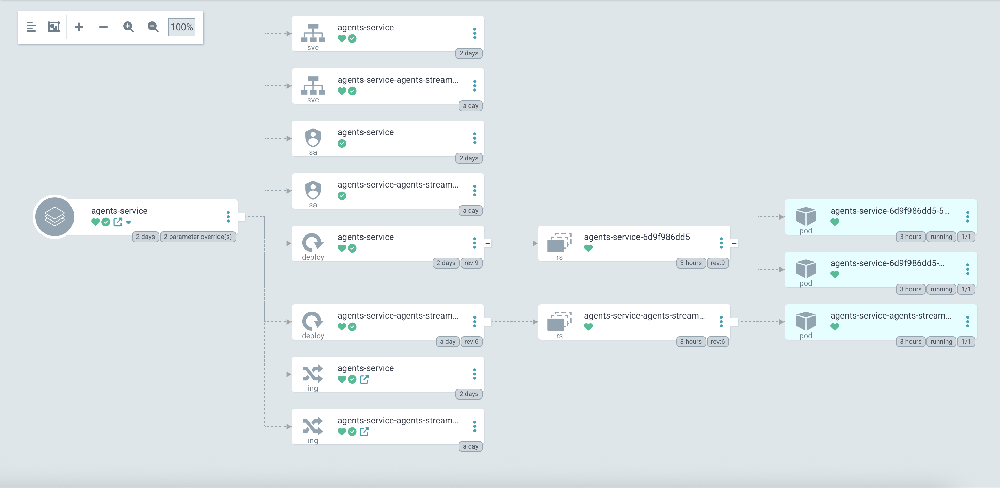

# 🧰 Kubernetes AI Agents Service

[](https://github.com/richardr1126/k8s-agents-service/blob/main/LICENSE)

A Kubernetes deployment of an AI agents service built with LangGraph and FastAPI, featuring a Helm chart with multi-architecture images and GitOps integration. Currently configured as a professional resume and portfolio showcase system with intelligent RAG-based assistance and specialized database analysis capabilities.

### Next.js Chat UI (`ui/`)

The repository now contains a second, production-focused chat interface built with **Next.js 15**, **React 19**, **assistant-ui**, and **Tailwind CSS 4**. This UI features enhanced tool visualization with contextual icons, transfer tool components for agent handoffs, smart input limits with visual feedback (560 character limit equivalent to 2 tweets), and improved user experience with intelligent routing feedback. It talks to the service over the [AG-UI protocol](https://docs.ag-ui.com) and is the only frontend.

This project extends [JoshuaC215's agent-service-toolkit](https://github.com/JoshuaC215/agent-service-toolkit) with Kubernetes deployment capabilities, including a Helm chart, ArgoCD integration, YugabyteDB support, and multi-architecture container builds.

> **⚠️ Important Notice**: This project is currently in development and is **not fully featured for production** use. While it provides a solid foundation for Kubernetes deployment of AI agents, additional hardening, monitoring, and operational considerations may be needed for production environments.

## 🙏 Acknowledgments

This project is built upon the excellent foundation provided by [JoshuaC215's AI Agent Service Toolkit](https://github.com/JoshuaC215/agent-service-toolkit). Special thanks to @JoshuaC215 for creating the original comprehensive toolkit that demonstrates best practices for LangGraph-based agent development.

## ✨ What's New in k8s-agents-service

This fork adds Kubernetes deployment capabilities on top of the original toolkit:

- **🎯 Kubernetes-Native**: Helm chart for the agent service
- **🔄 GitOps Ready**: ArgoCD application manifests for automated deployments  
- **🗄️ YugabyteDB Integration**: Distributed SQL database with pgvector extensions for RAG capabilities
- **🏗️ Multi-Architecture**: Docker builds for both AMD64 and ARM64 architectures for the service and cron containers
- **📦 Container Registry**: Automated builds and publishing to GitHub Container Registry with separate image streams
- **🔧 Deployment Scripts**: Comprehensive deployment automation with database setup, secrets management, and dependency updates
- **🔌 MCP Integration**: Model Context Protocol server support for advanced database analysis and tool execution
- **🔍 Enhanced Search**: Tavily search integration for improved web research capabilities

## Overview

### Core Features (from original toolkit)

1. **LangGraph Agent and latest features**: A customizable agent built using the LangGraph framework. Implements the latest LangGraph v0.6+ features including human in the loop with `interrupt()`, flow control with `Command`, long-term memory with `Store`, and `langgraph-supervisor` with intelligent auto-routing capabilities.
1. **FastAPI Service**: Serves the agents with a non-streaming `/invoke` endpoint and an [AG-UI](https://docs.ag-ui.com) event stream, see [API](#api).
1. **Sub-agent streaming**: Sub-agents run by the auto-router stream their own text and tool calls, tagged with a `subagentRunId`, and are stored with the thread so `/history` can rebuild them.
1. **Next.js Chat UI**: Modern production-focused React/Next.js application - [see UI README](ui/README.md)
1. **Multiple Agent Support**: Run multiple agents in the service and call by URL path. Available agents and models are described in `/info`
1. **Asynchronous Design**: Utilizes async/await for efficient handling of concurrent requests.
1. **Content Moderation**: Implements LlamaGuard for content moderation (requires Groq API key).
1. **RAG Agent**: RAG implementation using PGVector with YugabyteDB - see [docs](docs/RAG_Assistant.md).
1. **MCP Integration**: Model Context Protocol (MCP) server integration for database analysis and tool execution.
1. **Thread Management**: Complete thread lifecycle management with proper deletion from both conversation memory (checkpointer) and long-term memory (store).
1. **Feedback Mechanism**: Includes a star-based feedback system integrated with LangSmith.
1. **Docker Support**: Includes Dockerfiles and a docker compose file for easy development and deployment.
1. **Testing**: Includes robust unit and integration tests for the full repo.

### New Kubernetes Features

1. **Helm Chart**: `agents-service` chart for the backend, with an optional CronJob
1. **ArgoCD Integration**: GitOps-ready application manifests for automated deployments
1. **YugabyteDB Support**: Enterprise-grade distributed SQL database with pgvector extension support for RAG capabilities
1. **Multi-Architecture Builds**: AMD64 and ARM64 Docker images for the service and cron job published to GitHub Container Registry
1. **Automated Deployment Scripts**: Deployment automation with database setup and dependency management
1. **Kubernetes Secrets Management**: Secure handling of API keys and database credentials with enhanced environment configuration
1. **Automated Cron Jobs**: Kubernetes CronJob support for scheduled tasks like vector database updates and maintenance
1. **MCP Server Integration**: Model Context Protocol server support for advanced database analysis and external tool integration

### Resume & Portfolio Features

1. **Auto-Router Agent**: Default intelligent supervisor that automatically routes queries between specialized agents based on context, now including database analysis capabilities
1. **Resume Agent**: AI assistant that showcases professional background, skills, and project experience using RAG
1. **Web RAG Agent**: Research assistant capable of browsing and summarizing web content using Tavily search integration
1. **Database Analyst Agent**: Specialized MCP-powered agent for analyzing the Cosmere Feed database, providing insights into user engagement, content trends, and feed performance metrics
1. **Enhanced Tool Communication**: Improved agent handoff system with visual UI components and contextual routing
1. **Professional UI**: Modern Next.js interface with custom favicon, task management components, responsive design, enhanced tool visualization, and smart input limits with real-time character counting (560 character limit)
1. **Portfolio Integration**: Automated vector database creation from GitHub projects and resume data
1. **Smart Search**: Intelligent filtering and source attribution in resume and project searches

### Automated Tasks & Cron Jobs

1. **Scheduled Vector Updates**: Automated cron job that refreshes vector databases with latest resume and project data
1. **Google Drive Integration**: Automatically syncs resume data from public Google Drive documents
1. **GitHub Repository Scanning**: Fetches and processes README files from project repositories for up-to-date documentation
1. **Configurable Scheduling**: Flexible cron schedule configuration (default: daily at 7 AM UTC)
1. **Dedicated Cron Container**: Purpose-built Docker image with Chromium and Playwright for web scraping tasks
1. **Kubernetes CronJob Management**: Full Kubernetes CronJob lifecycle with history limits, concurrency policies, and failure handling

### ArgoCD Diagram



## 🚀 Quickstart

### Local Development (Docker)

```sh
# At least one LLM API key is required
echo 'OPENROUTER_API_KEY=your_openrouter_api_key' >> .env

# Run with docker compose watch for live reloading
docker compose watch
```

### Local Development (Python)

```sh
# uv is the recommended way to install dependencies
curl -LsSf https://astral.sh/uv/install.sh | sh

# Install dependencies and run
uv sync --frozen
source .venv/bin/activate
python src/run_service.py

# In another shell, the Next.js UI (see ui/README.md)
cd ui && pnpm install && pnpm dev
```

### Kubernetes Deployment

```sh
# Clone the repository
git clone https://github.com/richardr1126/k8s-agents-service.git
cd k8s-agents-service

# Configure environment variables
cp helm/.env.example helm/.env
# Edit helm/.env with your API keys and secrets

# Deploy to Kubernetes with YugabyteDB
cd helm
./manual_deploy.sh
```

For ArgoCD deployments, see the k3s-cluster repo (`argocd/apps/`). `helm/argocd.yaml` is outdated.

### Key Files

The repository is structured as follows:

**Core Application:**
- `src/agents/`: Defines several agents with different capabilities
- `src/schema/`: Defines the protocol schema  
- `src/core/`: Core modules including LLM definition and settings
- `src/service/service.py`: FastAPI service to serve the agents
- `src/service/agui.py`: AG-UI streaming endpoint (ag-ui-langgraph)
- `src/service/history.py`: rebuilds a thread's AG-UI history, sub-agent runs included
- `ui/`: Next.js chat UI
- `tests/`: Unit and integration tests

**Kubernetes Deployment:**
- `helm/agents-service/`: Complete Helm chart for the backend service
- `helm/argocd.yaml`: outdated ArgoCD application manifest (reference only; see k3s-cluster)
- `helm/manual_deploy.sh`: Deployment script with YugabyteDB setup
- `helm/create_secrets.sh`: Kubernetes secrets management script
- `docker/`: Multi-architecture Dockerfiles for the service and cron job builds
- `scripts/create_resume_vectors_cron.py`: Automated vector database update script for scheduled execution

## Setup and Usage

1. Clone the repository:

   ```sh
   git clone https://github.com/richardr1126/k8s-agents-service.git
   cd k8s-agents-service
   ```

2. Set up environment variables:
   Create a `.env` file in the root directory. At least one LLM API key or configuration is required. See the [`.env.example` file](./.env.example) for a full list of available environment variables, including a variety of model provider API keys, header-based authentication, LangSmith tracing, testing and development modes, OpenWeatherMap API key, and PostgreSQL MCP URL configuration.

3. You can now run the agent service locally, either with Docker or just using Python. The Docker setup is recommended for simpler environment setup and immediate reloading of the services when you make changes to your code.

### Additional setup for specific AI providers

- [Setting up Ollama](docs/Ollama.md)
- [Setting up RAG with PGVector](docs/RAG_Assistant.md)
- [Thread Deletion API](docs/Thread_Deletion.md)

### Building or customizing your own agent

To customize the agent for your own use case:

1. Add your new agent to the `src/agents` directory. You can copy `rag_assistant.py` (resume agent) or `web_rag_agent.py` and modify it to change the agent's behavior and tools.
1. Import and add your new agent to the `agents` dictionary in `src/agents/agents.py`. Your agent can be called by `/<your_agent_name>/invoke` or `/<your_agent_name>/ag-ui`.
1. Adjust the Next.js UI in `ui/` to match your agent's capabilities.
1. Update the `DEFAULT_AGENT` constant in `src/agents/agents.py` to set your preferred default agent (currently set to "auto-router" for intelligent routing).
1. For supervisor-style routing, configure the routing logic in `src/agents/main_agent.py` to define how queries should be distributed between your specialized agents.

### Current Available Agents

- **auto-router** (default): Intelligent supervisor agent that automatically routes queries between the resume agent, web research agent, and database analyst based on context
- **resume-agent**: Professional resume assistant that searches through resume information and project repositories
- **web-rag-agent**: Web research assistant that can browse the internet and summarize articles
- **postgres-mcp-agent**: Database analyst for the Cosmere Feed - a custom Bluesky feed featuring Brandon Sanderson's Cosmere series content. Analyzes PostgreSQL database containing feed requests and posts data to provide insights about user engagement, content trends, and feed performance
- **chatbot**: Simple conversational agent for general purpose chat


### Database Configuration

This fork uses **YugabyteDB with pgvector** instead of the original PostgreSQL/ChromaDB setup, providing several advantages:

**YugabyteDB Benefits:**
- **Distributed SQL**: Horizontal scaling and high availability out of the box
- **PostgreSQL Compatibility**: Full SQL compliance with familiar PostgreSQL interfaces  
- **Built-in pgvector**: Native vector similarity search for RAG applications
- **Enterprise-Grade**: Reliability and performance features

**RAG Implementation:**
- **PGVector Integration**: Uses `langchain-postgres` with PGVector for vector storage and retrieval
- **Multiple Collections**: Supports multiple knowledge bases (e.g., "richard-projects" collection)
- **OpenRouter Embeddings**: Uses `qwen/qwen3-embedding-8b` for vector generation
- **Automatic Setup**: Database schema and vector extensions are automatically configured

The system supports three database options:
- **YugabyteDB**: Distributed SQL with pgvector extensions (recommended)
- **PostgreSQL**: Traditional PostgreSQL with pgvector extension  
- **SQLite**: Local development and testing

### Resume & Portfolio Data Setup

The current implementation includes automated scripts for creating vector databases from resume and project data:

- `scripts/create_resume_vectors.py`: Creates vector embeddings from resume data in `data/richard-resume/`
- `data/richard-projects/`: Contains markdown files describing various projects
- `data/richard-resume/`: Contains structured resume information (education, skills, experience)

To adapt this for your own portfolio:

1. Replace the content in `data/` directories with your own resume and project information
2. Run the vector creation scripts to populate your knowledge base
3. Update agent descriptions in `src/agents/agents.py` to reflect your professional background

### Handling Private Credential files

If your agents or chosen LLM require file-based credential files or certificates, the `privatecredentials/` has been provided for your development convenience. All contents, excluding the `.gitkeep` files, are ignored by git and docker's build process. See [Working with File-based Credentials](docs/File_Based_Credentials.md) for suggested use.


### Kubernetes Deployment

This repository includes comprehensive Kubernetes deployment capabilities using Helm charts and GitOps with ArgoCD.

#### Prerequisites

- Kubernetes cluster (1.19+)
- Helm 3.x
- YugabyteDB or PostgreSQL database
- Docker registry access (GitHub Container Registry)

#### Environment Configuration

The deployment uses an enhanced environment configuration with separate secrets for different components:

```bash
# Core authentication and database
AUTH_SECRET=your-bearer-token-secret
ADMIN_POSTGRES_PASSWORD=admin-database-password  
APP_POSTGRES_PASSWORD=application-database-password

# API Keys
OPENROUTER_API_KEY=your-openrouter-key
LANGSMITH_API_KEY=your-langsmith-key  
GITHUB_PAT=your-github-token-for-container-registry

# MCP Configuration (for database analysis agent)
POSTGRES_MCP_URL=http://host.docker.internal:8000/sse
```

#### Quick Deploy with Helm

```sh
# Navigate to helm directory
cd helm

# Copy and configure environment variables
cp .env.example .env
# Edit .env with your API keys, database passwords, and GitHub PAT

# Run the deployment script (includes YugabyteDB setup)
./manual_deploy.sh
```

This script will:
- Build and push multi-architecture Docker images for the service to GitHub Container Registry
- Set up YugabyteDB user and database with vector extensions
- Create Kubernetes secrets with your API keys and configuration
- Deploy the agents-service chart with Helm

#### GitOps with ArgoCD

> **Outdated:** the ArgoCD Application for this service now belongs in the k3s-cluster repo
> (`argocd/apps/`). The steps below are the old way and no longer work as written.

For GitOps deployments, use the included ArgoCD application manifest:

```sh
# Create secrets manually
./create_secrets.sh

kubectl apply -f helm/argocd.yaml
```

#### Manual Helm Deployment

```sh
# Create secrets manually
./create_secrets.sh

# Install with Helm
helm install agents-service ./agents-service \
  --set image.repository=ghcr.io/richardr1126/k8s-agents-service \
  --set image.tag=latest
```

#### Automated Tasks with CronJobs

The deployment includes a Kubernetes CronJob for automated maintenance tasks:

**Cron Job Features:**
- **Automated Vector Database Updates**: Scheduled refresh of resume and project data
- **Google Drive Integration**: Syncs data from public Google Drive documents using `GDRIVE_DOC_ID`
- **Web Scraping**: Uses Chromium and Playwright to extract data from portfolio websites
- **GitHub Repository Processing**: Automatically fetches and processes README files from project repositories

**Configuration:**
```yaml
# helm/agents-service/values.yaml
cronjob:
  enabled: true
  schedule: "0 7 * * *"  # Daily at 7 AM UTC
  concurrencyPolicy: Forbid
  image:
    repository: ghcr.io/richardr1126/k8s-agents-cron
    tag: "latest"
```

**Required Environment Variables:**
- `GDRIVE_DOC_ID`: Google Drive document ID for resume data
- All database connection variables for vector storage
- `OPENROUTER_API_KEY`: For model inference and embeddings
- `POSTGRES_MCP_URL`: For database analysis capabilities (if using MCP agent)

#### Database Support

- **YugabyteDB**: Distributed SQL with vector extensions (recommended)
- **PostgreSQL**: Traditional PostgreSQL with pgvector extension
- **SQLite**: For development only

### Docker Setup

This project includes a Docker setup for easy development and deployment. The `compose.yaml` file defines the `postgres`, `agent_service` and `postgres-mcp` services. The Dockerfiles are in `docker/`.

For local development, we recommend using [docker compose watch](https://docs.docker.com/compose/file-watch/). This feature allows for a smoother development experience by automatically updating your containers when changes are detected in your source code.

1. Make sure you have Docker and Docker Compose (>=[2.23.0](https://docs.docker.com/compose/release-notes/#2230)) installed on your system.

2. Create a `.env` file from the `.env.example`. At minimum, you need to provide an LLM API key (e.g., OPENROUTER_API_KEY).
   ```sh
   cp .env.example .env
   # Edit .env to add your API keys
   ```

3. Build and launch the services in watch mode:

   ```sh
   docker compose watch
   ```

   This will automatically:
   - Start a PostgreSQL database service that the agent service connects to
   - Start the agent service with FastAPI

4. The services will now automatically update when you make changes to your code:
   - Changes in the relevant python files and directories will trigger updates for the relevant services.
   - NOTE: If you make changes to the `pyproject.toml` or `uv.lock` files (such as adding dependencies), you will need to rebuild the services by running `docker compose up --build`.

5. Run the Next.js UI:
   ```sh
   cd ui
   pnpm install  # or npm/yarn
   cp .env.example .env.local
   # Adjust environment variables as needed - see ui/README.md
   pnpm dev
   ```
   The Next.js app will be available at `http://localhost:3000`.

6. The agent service API will be available at `http://0.0.0.0:8080`. You can also use the OpenAPI docs at `http://0.0.0.0:8080/redoc`.

7. Use `docker compose down` to stop the services.

This setup allows you to develop and test your changes in real-time without manually restarting the services.

### API

- `POST /{agent_id}/ag-ui`: runs an agent and streams [AG-UI](https://docs.ag-ui.com) events (`text/event-stream`). The body is an AG-UI `RunAgentInput`; `forwardedProps.model` picks the model and `forwardedProps.user_id` is passed to the agent. To answer an interrupt, send its id back in `resume`. Events from a sub-agent carry a `subagentRunId` and sit between its `SUBAGENT_STARTED` and `SUBAGENT_FINISHED`/`SUBAGENT_ERROR`, which come before the parent `task` call's `TOOL_CALL_RESULT`. An interrupt, including one raised inside a sub-agent, ends the run with `RUN_FINISHED.outcome` of type `interrupt`.
- `POST /history`: `{"thread_id"}` returns `{"messages", "subagents"}`: the thread's AG-UI messages, with each sub-agent's messages (tagged with `subagentRunId`) just before its `task` result, and one `{subagentRunId, parentToolCallId, name, description, status, error?}` entry per sub-agent run.
- `POST /{agent_id}/invoke`: runs an agent and returns its final message.
- `DELETE /thread`: deletes a thread's checkpoints, sub-agent runs included, and its long-term memory.
- `GET /info`, `POST /feedback`, `GET /health`.

When `AUTH_SECRET` is set, every endpoint except `/health` needs `Authorization: Bearer <AUTH_SECRET>`.

### Development with LangGraph Studio

The agent supports [LangGraph Studio](https://langchain-ai.github.io/langgraph/concepts/langgraph_studio/), the IDE for developing agents in LangGraph.

`langgraph-cli[inmem]` is installed with `uv sync`. You can simply add your `.env` file to the root directory as described above, and then launch LangGraph Studio with `langgraph dev`. Customize `langgraph.json` as needed. See the [local quickstart](https://langchain-ai.github.io/langgraph/cloud/how-tos/studio/quick_start/#local-development-server) to learn more.

### Local development without Docker

You can also run the agent service locally without Docker, just using a Python virtual environment.

1. Create a virtual environment and install dependencies:

   ```sh
   uv sync --frozen
   source .venv/bin/activate
   ```

2. Run the FastAPI server:

   ```sh
   python src/run_service.py
   ```

3. In a separate terminal, run the Next.js UI as described in [ui/README.md](ui/README.md).

## Projects built with or inspired by the original agent-service-toolkit

The following are projects that drew code or inspiration from [JoshuaC215's original agent-service-toolkit](https://github.com/JoshuaC215/agent-service-toolkit):

- **[k8s-agents-service](https://github.com/richardr1126/k8s-agents-service)** (This repo) - Kubernetes deployment with Helm charts and YugabyteDB integration
- **[PolyRAG](https://github.com/QuentinFuxa/PolyRAG)** - Extends agent-service-toolkit with RAG capabilities over both PostgreSQL databases and PDF documents
- **[alexrisch/agent-web-kit](https://github.com/alexrisch/agent-web-kit)** - A Next.JS frontend for agent-service-toolkit
- **[raushan-in/dapa](https://github.com/raushan-in/dapa)** - Digital Arrest Protection App (DAPA) enables users to report financial scams and frauds efficiently via a user-friendly platform

If you've built something using this template, please create a pull request or open a discussion to be added to the list!

## Contributing

Contributions are welcome! Please feel free to submit a Pull Request. Currently the tests need to be run using the local development without Docker setup. To run the tests for the agent service:

1. Ensure you're in the project root directory and have activated your virtual environment.

2. Install the development dependencies and pre-commit hooks:

   ```sh
   uv sync --frozen
   pre-commit install
   ```

3. Run the tests using pytest:

   ```sh
   pytest
   ```

## License

This project is licensed under the MIT License - see the LICENSE file for details.
